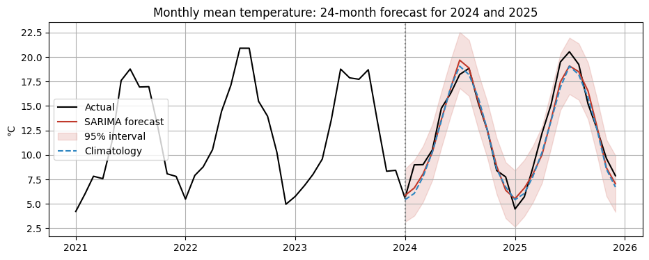
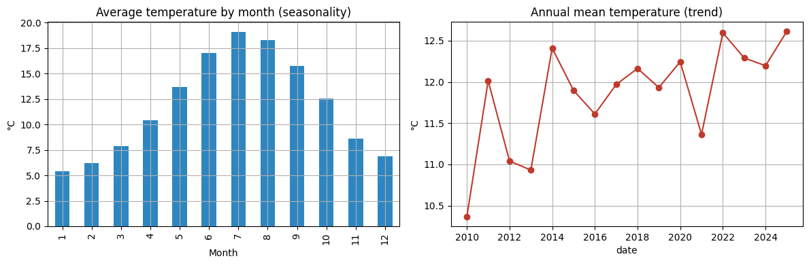
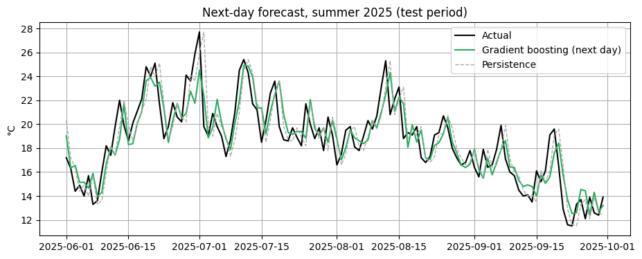

# London Weather Forecasting (Heathrow, 2010 to 2025)

Forecasting London's daily average temperature from 16 years of real weather station data, comparing simple baselines against a seasonal time series model (SARIMA) and machine learning (gradient boosting).



## Data

- **Source:** daily observations from the Heathrow weather station (WMO 03772) via [Meteostat](https://meteostat.net), licence CC BY-NC 4.0.
- **Period:** 1 January 2010 to 31 December 2025, 5,844 days.
- **Variables:** daily average, minimum and maximum temperature (°C), precipitation (mm).
- File: `london_heathrow_daily_2010_2025.csv`

## Method

1. **Cleaning:** a few missing min/max values were filled by time interpolation; missing rainfall was set to 0.
2. **Exploration:** rolling means, monthly profile (seasonality) and annual means (trend).
3. **Decomposition:** monthly series split into trend, seasonal and residual parts.
4. **Time-based split:** train on 2010 to 2023 and test on 2024 to 2025, so the models never see the future.
5. **Two forecasting tasks:**
   - **Long range (monthly, 24 months ahead):** seasonal naive, climatology and SARIMA(1,0,0)(1,1,1,12).
   - **Next day (daily):** persistence ("tomorrow = today"), daily climatology, linear regression and gradient boosting, using lagged temperatures, rolling means and day-of-year sine/cosine features.

## Results (test period 2024 to 2025)

| Task | Model | MAE (°C) | RMSE (°C) |
| --- | --- | --- | --- |
| Monthly, 24 months ahead | Seasonal naive | 1.37 | 1.66 |
| | Climatology | 0.98 | 1.23 |
| | **SARIMA** | **0.96** | **1.16** |
| Next day | Daily climatology | 2.30 | 2.96 |
| | Persistence | 1.60 | 2.04 |
| | Linear regression | 1.43 | 1.82 |
| | **Gradient boosting** | **1.43** | **1.83** |



## Key findings

- **Seasonality dominates:** about 13.5 °C between the warmest month (July, 19.1 °C) and the coldest (January, 5.4 °C).
- **Warming trend:** annual mean temperature rose by roughly 0.9 °C per decade over 2010 to 2025. The window is short, so treat this as indicative.
- **Long-range planning:** SARIMA and climatology both beat repeating last year by about 30%, because any single year can be unusually warm or cold.
- **Next day:** models using recent days plus the time of year cut error by about 11% compared with "tomorrow = today". A simple linear model matches gradient boosting here, so the simpler model is the better choice.



## How to run

```bash
pip install -r requirements.txt
jupyter notebook london_weather_forecasting.ipynb
```

## Tools

Python, pandas, NumPy, statsmodels (seasonal decomposition, SARIMA), scikit-learn, Matplotlib.

## Related

- [Advanced Time Series Forecasting with LSTM](https://github.com/KainatAzhar/Advanced-Time-Series-Forecasting-with-LSTM)
